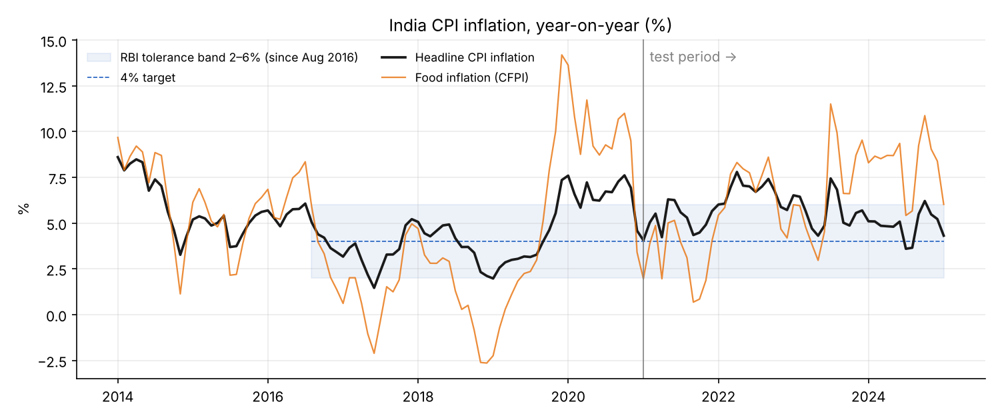
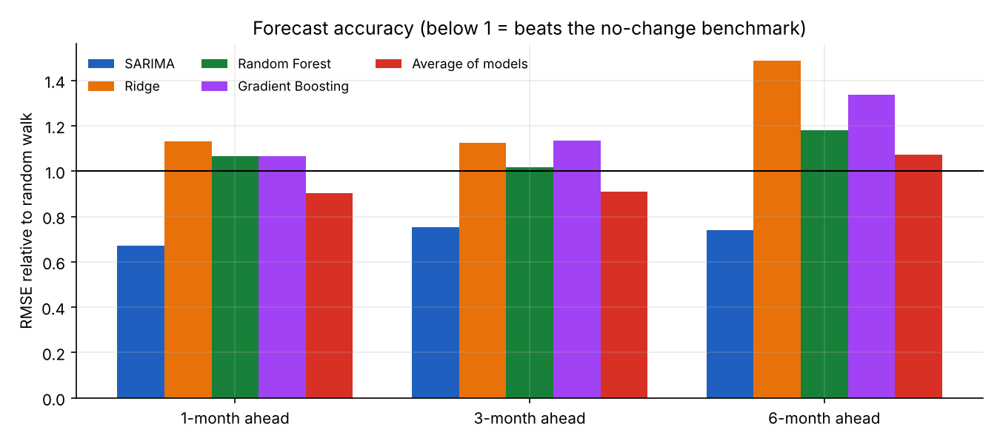
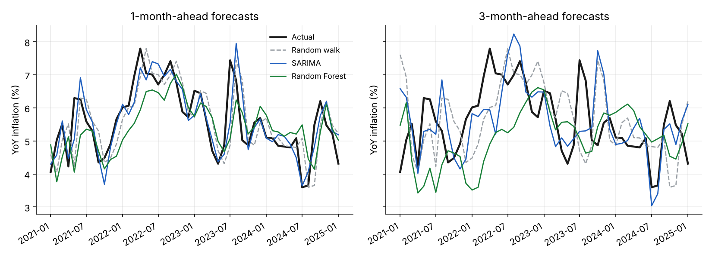
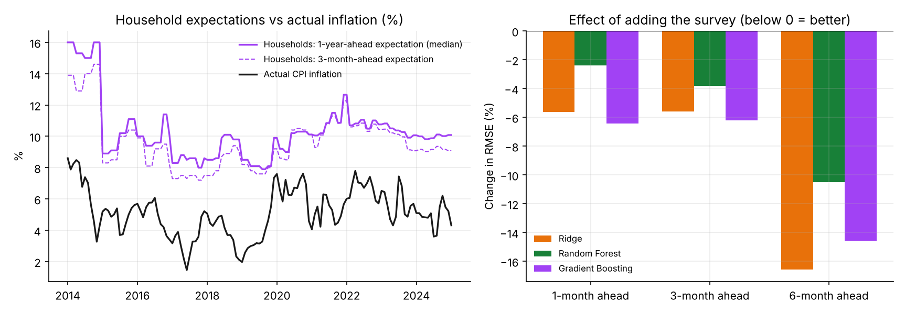

# Forecasting India's CPI Inflation: SARIMA vs Machine Learning

Can machine-learning models forecast India's headline CPI inflation better than a classical seasonal ARIMA model? This project runs a pseudo out-of-sample backtest on official MOSPI data, in the style of the forecast evaluations used at central banks.

**Short answer:** no, not with a decade of monthly data. A parsimonious SARIMA model is the most accurate at 1, 3 and 6 months ahead, reducing forecast error by 25–33% relative to a no-change benchmark. Machine-learning models overfit the small sample and do not beat the benchmark overall, though they improve as more training data accumulates. Adding RBI's survey of household inflation expectations makes every ML model more accurate, by 2–17% depending on the horizon.



## Data

| | |
|---|---|
| Source | Ministry of Statistics and Programme Implementation (MOSPI), Consumer Price Index, base year 2012 |
| Coverage | All-India, Combined (rural + urban), monthly, January 2013 to January 2025 (145 months) |
| Series used | General index (headline), Consumer Food Price Index (CFPI), Fuel and Light, Miscellaneous |
| Target | Year-on-year headline inflation (%) |
| Validation | Inflation recomputed from the index matches MOSPI's published rates to within 0.01 pp (e.g. Oct 2024: 6.21%, Dec 2024: 5.22%, Jan 2025: 4.31%) |

**Household inflation expectations:** RBI's Inflation Expectations Survey of Households (IESH), median current perception and 3-month and 1-year-ahead expectations for every round from September 2009 to November 2025 (`data/raw/IESH05122025.xlsx`, from the December 2025 release). Values match the published May 2025 release (7.7%, 8.9% and 9.5%).

The CPI raw file (`data/raw/`) is an All-India extract of MOSPI CPI data collected from MOSPI's API by the open-source project [india-CPI-analysis](https://github.com/MMadhu2000/india-CPI-analysis) (MIT licence).

## Method

**Expanding-window backtest.** For every month from January 2021 to January 2025, each model is trained only on data available *h* months earlier and forecasts inflation for that month. That gives 49 genuine out-of-sample forecasts per horizon (h = 1, 3, 6). The test window covers both the 2022 inflation surge and the 2023–25 disinflation.

| Model | Description |
|---|---|
| Random walk | Inflation in *h* months = inflation today. The benchmark to beat. |
| SARIMA | Seasonal ARIMA on log CPI, (0,1,1)(0,1,1)₁₂ chosen by AIC on pre-2021 data only, re-estimated at every origin. Inflation is derived from the forecast price path. |
| Ridge | Penalised linear regression (cross-validated penalty) |
| Random Forest | 500 trees, minimum leaf size 3 |
| Gradient Boosting | 300 shallow trees (depth 2), learning rate 0.03 |
| Average of models | Equal-weight mean of SARIMA, Ridge, Random Forest and Gradient Boosting, fixed before seeing results |

The ML models are *direct* forecasters (one model per horizon) using 38 predictors: 12 lags of headline inflation; 3 lags each of food, fuel and miscellaneous inflation; 3 lags of month-on-month changes in the headline and food indices; and target-month dummies.

**Survey experiment.** Each ML model is also run with five extra predictors from the household survey: the latest median current perception, 3-month and 1-year expectations, and the change in the 3-month and 1-year expectations since the previous round. A round surveyed in month *m* is used only from month *m + 1*, after RBI has published it. Everything else is identical, so the comparison isolates the survey's contribution.

Accuracy is measured by RMSE and MAE. Differences from the benchmark are tested with the Diebold-Mariano test (Harvey, Leybourne and Newbold small-sample correction).

## Results

**RMSE relative to the random walk** (below 1 = more accurate than the benchmark):

| Model | 1 month | 3 months | 6 months |
|---|---|---|---|
| **SARIMA** | **0.67** | **0.75** | **0.74** |
| Average of models | 0.90 | 0.91 | 1.07 |
| Random Forest | 1.07 | 1.02 | 1.18 |
| Gradient Boosting | 1.07 | 1.13 | 1.34 |
| Ridge | 1.13 | 1.12 | 1.49 |

| | 1 month | 3 months | 6 months |
|---|---|---|---|
| Random walk RMSE (pp) | 0.84 | 1.38 | 1.40 |
| SARIMA RMSE (pp) | 0.57 | 1.04 | 1.04 |
| Diebold-Mariano p-value, SARIMA vs random walk | 0.002 | 0.011 | 0.016 |





**By period (RMSE, pp):**

| Period | Model | 1 month | 3 months | 6 months |
|---|---|---|---|---|
| 2021–22 surge | Random walk | 0.75 | 1.35 | 1.64 |
| | SARIMA | **0.47** | **1.06** | **1.20** |
| | Random Forest | 0.94 | 1.69 | 2.18 |
| 2023–25 disinflation | Random walk | 0.93 | 1.41 | 1.12 |
| | SARIMA | **0.64** | **1.01** | 0.85 |
| | Random Forest | 0.85 | 1.06 | 0.87 |
| | Average of models | 0.75 | 1.03 | **0.79** |

### Do household inflation expectations help?

**Yes, for the ML models.** Adding the survey lowers forecast error for all three models at all three horizons:

| Model | 1 month | 3 months | 6 months |
|---|---|---|---|
| Ridge | −5.6% (p = 0.008) | −5.6% | −16.6% |
| Random Forest | −2.4% (p = 0.007) | −3.8% | −10.5% |
| Gradient Boosting | −6.4% (p = 0.020) | −6.2% | −14.6% (p = 0.09) |

*Change in RMSE from adding the survey; p-values from Diebold-Mariano tests of with- vs without-survey, shown where below 0.10.*

The gains are statistically significant at 1 month, and largest but less certain at 6 months. With the survey, the Random Forest beats the no-change benchmark at 3 months (relative RMSE 0.98), but SARIMA remains the most accurate model overall.



Households' expectations sit well above actual inflation (around 9–10% against 4–6% in recent years), so the survey's *level* is a poor forecast on its own. What helps is the information in its movements. Note also the sharp fall in December 2014, which appears to reflect a change in the survey rather than in households' views.

Full results: [`results/metrics.csv`](results/metrics.csv), [`results/rmse_by_period.csv`](results/rmse_by_period.csv), [`results/survey_ablation.csv`](results/survey_ablation.csv), every forecast in [`results/forecasts.csv`](results/forecasts.csv).

### Independent replication in R

[`R/sarima_backtest.R`](R/sarima_backtest.R) re-runs the SARIMA backtest in base R (`stats::arima`, exact maximum likelihood) as a check on the Python results:

| Horizon | Random walk RMSE | SARIMA RMSE (R) | SARIMA RMSE (Python) | Relative RMSE (R) | DM p-value (R) |
|---|---|---|---|---|---|
| 1 month | 0.84 | 0.58 | 0.57 | 0.68 | 0.002 |
| 3 months | 1.38 | 1.03 | 1.04 | 0.75 | 0.013 |
| 6 months | 1.40 | 1.02 | 1.04 | 0.73 | 0.030 |

The small differences come from the two libraries' estimation methods; the conclusion is the same.

## Findings

1. **SARIMA wins at every horizon**, and the improvement over the benchmark is statistically significant (p < 0.02).
2. **Machine learning does not beat the benchmark over the full test window.** With 60–120 training observations and 38 predictors, the models overfit and react late to turning points, most visibly in the 2022 surge.
3. **ML improves with more data.** In 2023–25, with longer training histories, the Random Forest beats the benchmark at 6 months, and the model average is the most accurate 6-month forecaster in that period.
4. **Household inflation expectations carry real information.** Adding RBI's survey improves every ML model at every horizon, significantly so at one month, even though households consistently overestimate inflation.
5. **Why SARIMA does well: base effects.** Next month's year-on-year rate compares next month's price level with the level 11 months ago, which is already known. Together with a stable seasonal pattern, this makes much of the short-run path of inflation mechanical. A model of the price level captures it directly; a model of the inflation rate has to learn it.

## Limitations and next steps

- One test window of 49 months per horizon. Rankings could change in other periods.
- Few external drivers. Natural additions beyond the household survey: crude oil prices, monsoon rainfall, the rupee exchange rate and the repo rate.
- The survey feature is tested only in the ML models; adding it to SARIMA (as an ARIMAX model) would need forecasts of future survey values.
- A hybrid model: SARIMA for the base-effect and seasonal structure, ML on SARIMA's residuals.
- Density (fan-chart) forecasts, as published in RBI's Monetary Policy Report.
- Data end in January 2025. MOSPI has since introduced a new CPI series with base year 2024, so check the base year before appending newer months.

## Reproduce

```bash
pip install -r requirements.txt
python src/run.py          # data -> backtest -> results/ and figures/ (about 5 minutes)
python -m pytest tests     # checks that no model sees future data, and data matches MOSPI
Rscript R/sarima_backtest.R   # optional: SARIMA replication in base R (needs results from run.py)
```

Or open [`notebooks/cpi_inflation_forecasting.ipynb`](notebooks/cpi_inflation_forecasting.ipynb) for the full walkthrough with outputs.

```
data/raw/            MOSPI CPI extract (All-India, base 2012) and RBI IESH survey (Dec 2025 release)
data/processed/      Clean monthly panel used by the models
src/data.py          Loading, inflation calculation, validation against MOSPI
src/survey.py        Household survey: parsing and publication-lagged monthly series
src/models.py        Random walk, SARIMA, Ridge, Random Forest, Gradient Boosting
src/evaluate.py      Expanding-window backtest, RMSE/MAE, Diebold-Mariano test
src/run.py           Runs everything and writes results and figures
R/sarima_backtest.R  SARIMA backtest replicated in base R
tests/               Look-ahead, survey-timing and data-consistency tests
notebooks/           Executed analysis notebook
```

## Author

Aman Hooda, B.Tech Computer Science and Engineering (Data Science), VIT Vellore. [amanhooda2746@gmail.com](mailto:amanhooda2746@gmail.com)
